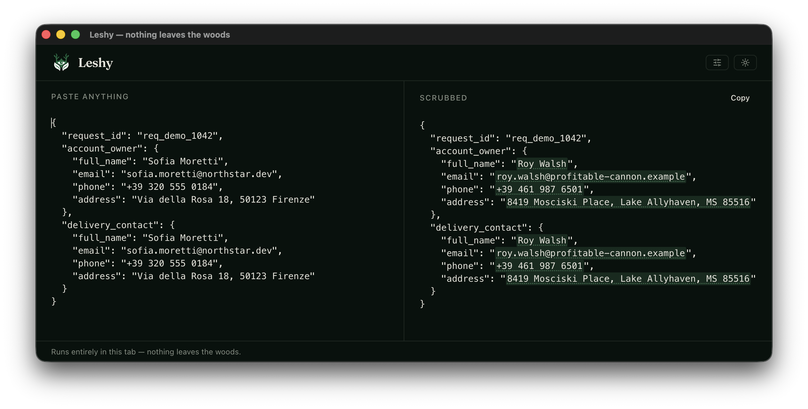

<p align="center">
  <picture>
    <source media="(prefers-color-scheme: dark)" srcset="assets/brand/leshy-mark-dark-1024.png">
    <source media="(prefers-color-scheme: light)" srcset="assets/brand/leshy-mark-light-1024.png">
    
  </picture>
</p>

<h1 align="center">Leshy</h1>

<p align="center"><strong>Nothing leaves the woods.</strong></p>

<p align="center">Clean sensitive data out of debugging output without sending it anywhere.</p>



Leshy is a local privacy tool for developers who want to share logs, JSON, Ruby inspects,
stack traces, or other production output with an LLM. Paste the original text, review the
clean result, and copy it out.

Names, email addresses, phone numbers, street addresses, organizations, PESEL and SSN
numbers, payment cards, IBANs, IP addresses, API keys, and other sensitive values are
replaced with realistic fakes. Formatting stays intact, and repeated values receive the
same replacement, so the result remains useful for debugging.

## Nothing leaves the woods

All processing happens on your computer. Leshy has no server, cloud API, telemetry, or
account. Pasted text is never persisted. The PWA works offline after its first model
download, while the desktop app includes the model in its bundle.

Always review the result before sharing it. Automated detection reduces risk, but cannot
guarantee that every possible secret or piece of personal information will be found.

## How Leshy finds PII

Leshy combines three kinds of detection:

1. **Structural checks** recognize formats such as email, phone, IBAN, PESEL, payment card,
   IP, JWT, API key, and UUID. Checksums validate formats where possible.
2. **Key context** recognizes sensitive values under keys such as `full_name`, `email`, or
   `address`, even when the surrounding text is not valid JSON.
3. **Local language model** finds names, organizations, and free-form addresses that do not
   have a reliable fixed pattern.

The language model is [`knowledgator/gliner-x-small`](https://huggingface.co/knowledgator/gliner-x-small),
a GLiNER zero-shot named-entity recognition model with an mT5-small encoder. Its quantized
ONNX weights are 172.7 MB, and the complete model download is about 189 MB including the
tokenizer. One model pass handles all semantic labels. It loads once in a Web Worker, uses
WebGPU when available, and falls back to WebAssembly. This keeps the interface responsive
and provides context-aware detection without a server or Python runtime.

The current model and validation corpus cover Polish and English. New structural detectors
or GLiNER labels can be added through `leshy.config.ts`.

## Run locally

### Web and PWA

```
npm install
npm run models:fetch   # one-time model download, about 189 MB
npm run dev
```

### Desktop app

```
npm run desktop        # build the shell and launch it
npm run desktop:pack   # release/mac-arm64/Leshy.app, drag it to /Applications
npm run desktop:dist   # .dmg on macOS, .AppImage on Linux
```

Linux builds cross-compile from macOS: `npx electron-builder --linux AppImage --x64`.
See [docs/adr/0007](docs/adr/0007-desktop-shell.md).

## Development

- `npm run check` / `npm run test` – quality checks
- `npm run spike` – full detection-pipeline validation against golden samples

Docs: [CLAUDE.md](CLAUDE.md) (operating manual) · [docs/architecture.md](docs/architecture.md) ·
[docs/adr/](docs/adr/) (decisions) · [docs/implementation-plan.md](docs/implementation-plan.md).
